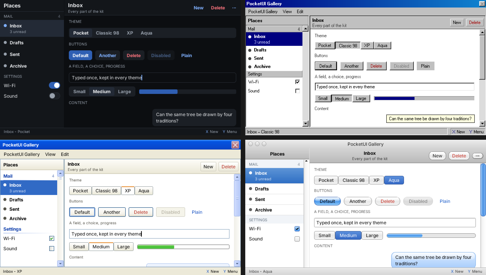

# PocketUI

A UI framework for [PocketJS](https://github.com/pocket-nexus/pocketjs) applications. An application written with it states what it is made of (panes, a feed, commands, a place to compose text, things that can be moved onto other things), and each device gets the idiom it can carry out in full: columns or one pane at a time, a button legend or bar controls, a drag or a pick-up with a button.

It is headless in the same sense for looks. An application names parts (a bar, a selected row, the default button, a field) and no colour, edge or font; a **theme** paints the parts and arranges the ones whose place is a matter of tradition. Four ship: Pocket, Classic 98, XP and Aqua. `ui.setTheme` changes the theme under a running application, and a draft, a caret, a scroll position and the focus stay where they were.

It was built to carry [Pocket Lody](https://github.com/pocket-nexus/pocket-lody), a client for a coding-agent workspace, on an AYN Thor, and the same application runs unchanged on a 320×240 touch surface and on a 480×272 screen with buttons and no touch (Pocket Lody's `test/app.test.ts` drives all three).

<p align="center"></p>

The picture is `gallery/main.tsx` in PocketJS's simulator at 640×360, in each of the four themes, switched while it ran: the text in the field was typed once.

**Status: 0.2, used by two applications** (Pocket Lody and the gallery). The names below are what the code exports today.

## Why it exists

PocketJS gives an application three node types (`View`, `Text`, `Image`) under a flexbox it cannot read back, and that is enough for a list of fixed rows. A transcript, an editor and a multi-pane tool need four things the base does not have:

| Needed | PocketJS | PocketUI |
| --- | --- | --- |
| The size text takes | Text does not wrap (a run breaks at `\n` only), and no laid-out rectangle reaches JavaScript | Breaks lines itself over `measureText` (`core/text.ts`, `core/rich.ts`), so a paragraph's height is known before it paints |
| Rows of unknown height, in thousands | `VirtualList` takes one fixed `rowHeight` | `Feed`: rows measured as they mount, the reader's place kept by an anchor (`core/feed.ts`) |
| A text field | `TextField` is one line with a caret index; the application owns everything else | `TextEditor`: caret, selection, IME preedit, atomic mention tokens, undo (`core/editor.ts`) |
| Where things are | Focus moves in document order; there is no hit rectangle to ask about | Every element's rectangle is known: focus moves by direction, a pan finds the scroll view under it, a menu opens beside its control |

So PocketUI lays out its own tree. PocketJS's nodes, its kinetic scroller, its gesture recognizer and its animations are used as they are.

## The model

### Elements, instances, one layout pass

A component is a function from props to an **element** (`{ kind, props }`, with the props Solid's JSX compiled as getters). A container makes each child element live as an **instance**: it owns one native node, positions it absolutely, and knows its rectangle.

```tsx
import { HStack, Spacer, Text, VStack } from "pocketui";

function Row(props: { title: string; detail: string; age: string }) {
  return (
    <HStack padding={[7, 10]} spacing={8} onPress={open}>
      <VStack grow={1} spacing={1}>
        <Text role="strong" lines={1}>{props.title}</Text>
        <Text role="caption" lines={1}>{props.detail}</Text>
      </VStack>
      <Text role="caption">{props.age}</Text>
    </HStack>
  );
}
```

- **Measuring is a function of the size offered**: `measure(maxW, maxH)` returns the size wanted, and results are cached per offer. **Placing writes the rectangle**: `place(x, y, w, h)`.
- **Reactivity is Solid's, per prop.** A prop that changes the size (text, padding, a child list) invalidates the path to the root; a prop that only paints (a colour) sets one native prop and no layout runs.
- **One pass per frame** measures and places what was invalidated. A feed that learns a row's height in a pass may ask for a second one in the same frame.
- **A render effect runs where it is created**, so an instance's effects that call overridable methods start in `mounted()`, after its constructors ran (`ui/engine.ts`).

`VStack` children take the stack's width unless `align` says otherwise; `HStack` children are centred across; `grow` shares the leftover main-axis room; `ZStack` children fill unless they have an `anchor`. Sizes are points. There are no percentages and no classes: a box's `background`, `radius`, `borderColor`, `opacity`, `shadow` and `clip` are props.

### Environment and idioms

`core/env.ts` separates facts from choices.

**Environment** is what the surface can do, derived from PocketJS's modality and the surface's size: its width class (`compact` under 420 points, `regular`, `expanded` from 560, `wide` from 840), whether contacts land on it, whether there are buttons, a pointer that hovers, keys that type, where typed text comes from (`keyboard`, `host`: a keyboard the host shows off the surface, `osk`: one the application draws), whether frames are cheap, and how much the realm can hold.

**Idioms** are what each of the application's semantics becomes there. `resolveIdioms(env)` picks, and an application may override a choice for itself.

| Semantic | Idioms | Chosen by |
| --- | --- | --- |
| Panes | `stack` · `split` · `triple` | width class |
| Focus | a ring the d-pad moves | buttons |
| Commands | a legend · bar controls · key chords · a menu as a sheet or a popover | buttons · contacts · keys · a hovering pointer |
| Composing text | `inline` · `dock` (the field and a drawn keyboard take the surface's bottom) | where text comes from |
| Moving a thing | `drag` · `carry` | contacts or not |
| A change of pane | `follow` the contact · `animate` · `cut` | contacts · what a frame costs |
| Density | `compact` · `regular` | either size class |
| Rich content | `full` · `plain` | what the realm can hold |

**The rule is completeness.** An idiom is chosen only when every step of it has an input on that surface: a surface without a pointer gets no control that needs hovering, and one without keys gets no command that exists only as a chord. `test/env.test.ts` states the result for six surfaces (a Thor window, a PSP, a 3DS touch screen, a uConsole, an e-paper panel, a desktop window).

The surface can change while the application runs. `ui.resize(width, height)` lays the same tree out again and re-derives the Environment; nothing remounts. Two windows tiled side by side on a Thor are each 306 points wide, and the application in each goes from `split` to `stack` with its transcript's place, its draft and its focus as they were.

### Panes

`Panes` takes a list, a detail and an inspector and a `depth` (0 the list alone, 1 a detail is open, 2 its inspector too). The three are the same three instances in every idiom (`ui/panes.ts`).

In `stack`, `Deck` carries the change between two panes (`ui/deck.ts`): with `follow`, a horizontal pan toward the previous pane drags both panes with the contact, and letting go past a third of the width (or faster than 350 points a second) completes the move back; otherwise both return. With `animate`, the incoming pane slides for 240 ms, and a second change while it plays starts from where the panes are, because the core's animations start from the current value. With `cut`, the next frame shows the new pane.

### Feed

Rows of any height and number. Only the rows within three quarters of a window of the visible part are mounted. The model keeps an **anchor** (the first row at least partly in view, and how far into it the window's top edge is) instead of an offset:

- rows added above, and heights learnt or corrected above the anchor, move the offset by exactly their size, so what is on screen stays where it was;
- while the reader is at the end the feed **follows** it as rows arrive and grow; scrolling up leaves follow, reaching the end re-enters it;
- `position()` returns the anchor to hand back as `position` later, so a transcript reopens where it was read.

A row is an ordinary element. When its content changes (a paragraph streaming in) it invalidates the feed, which measures it again and rebases the scroller in the same pass.

### Text, in any script

`Text` wraps one style; `RichText` wraps several (bold beside regular, `code` in a sentence, a mention), breaking at spaces, on either side of a CJK character and never before closing punctuation, and never inside a word whose style changes mid-way.

The type ramp is five baked slots (12 px regular and bold, 14 px bold, 12 px monospace, 10 px). **At raster density 3 a 12 px slot is about 220 KiB, and an applet's pack is at most 3 MiB.** Text the baked faces cannot draw goes to a resolver the application installs (`setFaceResolver`): Pocket Lody's asks the companion's glyphs service for an atlas and draws from slots 21 and 22.

`Markdown` maps a parsed document (`core/markdown.ts`: fences, lists, quotes, tables, emphasis next to CJK without spaces) to elements. A block keeps its element while its content is the same, and a paragraph, heading or fence that only grew keeps its element and changes its text, so an answer being streamed lays out its last block and nothing above it. The parser reads a 64 KB document in under 1 ms on an M-series Mac.

### TextEditor

The host sends text events (committed text, named keys, preedit updates). The model in `core/editor.ts` owns every editing rule: a string plus token ranges, a caret that never rests inside a token or a surrogate pair, stepping by cluster (combining marks, ZWJ sequences, flag pairs), word motion that treats each CJK character as a word, an IME preedit spliced into the text and excluded from what is sent and from undo, vertical motion over the lines as drawn. The element lays the document out with `core/rich.ts`, draws the caret, the selection and the preedit's underline, and places the caret where a tap lands.

A field takes the keyboard when it is tapped or confirmed with the focus on it, and gives it up on Escape or a tap elsewhere. While it has the keyboard on a host that shows its own (`HostOps.textSession`), the pad's buttons arrive as keys and are not also commands.

`editor.model.trigger(["@"])` reports the completion being typed; `insertToken` replaces it with an atomic token.

### Commands

```ts
useCommands(() => [
  { id: "session.new", title: "New Session", short: "New", button: "action", key: "Control+n", bar: true, run },
  { id: "session.stop", title: "Stop the Agent", short: "Stop", button: "action", bar: true, destructive: true, disabled: !running(), run },
]);
```

A command is declared once and every surface offers it somewhere (`core/commands.ts`):

- **buttons**: a command may ask for a free button by intent (`action` is Triangle or X, `option` is Square or Y, `menu` is START). The legend names what each button does now. A command with no button is in the menu, which has one.
- **a bar**: where contacts land, commands marked `bar` show as controls and the rest sit behind the bar's `...`.
- **keys**: a command's chord runs it, and the menu shows the chord beside the title.

One meaning per control: a button never means two things by how often or how long it is pressed. A command that does not apply is disabled in place, and its button goes to the next scope out. A scope whose pane holds the focus is asked first. `useBack` declares what Back does; the innermost handler that returns true ends the press.

### Transfer

A source gives an item, a target says what it accepts and what a drop does (`ui/transfer.ts`). With `drag`, a long press lifts the item, a chip follows the contact, a target under it that accepts shows it would, and letting go elsewhere puts it back. With `carry`, a command picks the focused item up, the legend reads Drop and Put Back, the focus moves as it always does, and confirm on a target drops. Both end in the same `drop(item)`; neither commits before the release or the confirm.

### Presentations

`present(ui, content, { style, title })` puts content over the application as a layer of its own: a scrim takes every contact outside the panel, the focus stays inside it, and Back dismisses it and nothing under it. The caller says what it presents and the theme decides the form: a `sheet` (a task) and a `menu` (a list of choices) rise from the bottom edge or open as a window; a `dialog` sits in the middle; a `popover` opens under an anchor (a menu bar's menu); a `side` panel covers the trailing edge. The `title` is a title bar with a close box where the theme's dialogs have one and a heading otherwise. `presentMenu` and `confirm` are built on it. A menu's rows are fixed when it opens.

### Themes

An element says what it is with `part` (and the state it is in with `selected`, `variant`, `tone`, `disabled`); the kit's components do that for you. The active theme answers with a `Paint`:

```tsx
<HStack part="row" selected={open()} onPress={pick}>
  <Text>{title}</Text>
  <Text role="caption" tone="muted">{detail}</Text>
</HStack>
```

| A theme gives | What it is | Where |
| --- | --- | --- |
| `paint(part, state)` | The fill or gradient, border or bevel rings, corner radius, shadow, the layers painted under the content (a gloss, a highlight strip, a second ring), the padding, and how far the content sinks when pressed | `Paint` in `core/theme.ts`; 45 parts in `PARTS` |
| Ink | The colour of text and marks by meaning (`tone`: plain, muted, faint, accent, good, warn, bad, note). A part can replace it for what is inside: the muted line of a selected row is not the muted line of the pane | `Paint.ink`, resolved up the tree (`Instance.inkFor`) |
| Faces | The type ramp by role (`body`, `strong`, `title`, `caption`, `mono`); a part can set the role of text that names none | `Theme.face`, `Paint.text` |
| Metrics | Bar, title bar, menu bar and status heights, row padding, a push button's height, the scroll bar's width, a title bar control's size | `Metrics` |
| Marks | A close box, a check, a chevron, drawn from rectangles: pixel rows (`bitmap`) or strokes (`stroke`). A mark a theme does not draw comes from a stock set | `Theme.glyph`, `core/glyphs.ts`, `<Glyph>` |
| Traits | The arrangement: is there a title bar, and which end are its controls at; a centred title; commands in a menu bar or in the pane's bar with the rest behind "more"; a scroll bar as a strip with arrows or a thumb that shows while the content moves; a menu as a sheet from the bottom edge or a window in the middle; the default button last or first | `Traits` |

What that buys, from one source:

| | Pocket | Classic 98 | XP | Aqua |
| --- | --- | --- | --- | --- |
| The application's frame | none | navy title bar, close box | blue title bar, red close box | title bar with three lights, centred title |
| Commands | bar controls, the rest in a sheet | a menu bar (one menu per `Command.menu`) and bar buttons | the same | toolbar capsules and "more" |
| Scroll bar | a pale thumb over the content while it moves | the same, dark | the same, blue | the same, grey |
| An inspector over another pane | a panel under the bars with a line and a shadow | a tool window's raised frame, with a close box in its heading | a blue-edged panel, with a red close box | a panel of the window's grey, with a red light in its heading |
| A pointer at rest | a tint on a row, a bar control or a menu row | the menu row or menu title under it in navy | the same in blue, and an orange ring on a push button | the menu row under it in blue |
| A task or a menu | a sheet from the bottom edge | a window with a title bar | the same | a window with a heading |
| Default button | filled, last | a black frame, first | a blue ring, first | a blue gel, last |
| A task's actions (`present({ actions })`) | the way out beside the heading, the thing to do as one wide button | push buttons at the foot, centred | push buttons at the foot, trailing | push buttons at the foot, trailing, Cancel first |
| One choice of several (`Picker`) | a row that opens the list | the label beside a combo box | the same | the label beside a popup with a blue cap |
| The panes' bars | each its own, absent where a pane has no title | the same | the same | one surface with the title bar: every pane has one, all of one height |
| Focus | a ring | a 1-point rectangle | an orange ring (inside a button) | a soft blue halo |
| Edges | flat grounds | two bevel rings, raised or sunken | rounded, under a 1-point line | gradients under a gloss |

The frame's parts only take a press for something they do. `Scaffold`'s close control runs the application's `onClose` (Pocket Lody closes the open session with it) and shows disabled while there is nothing to close; a theme that always shows three lights draws the other two disabled.

The rule this rests on: **what a tradition arranges differently, the application does not draw.** It does not place a dialog's buttons, it says what the dialog does (`actions`); it does not build a row or a popup for a choice, it says what is chosen from what (`Picker`); it does not size a control, the theme's metrics do (every push control is `metric.control` tall and no push button is narrower than `metric.buttonMin`; a bar's controls are one height, a mark alone as tall as a word). When a theme looks wrong, the fix belongs in the theme or in the kit, and if it cannot be made there, the kit is missing a semantic.

Nothing in an application or in the kit asks which theme is active. Two rules keep a change of theme from losing state: what holds state (a scroll view, a field, a pane) is made once and stays where it is in the tree, and only stateless chrome (a title bar, a row of dialog buttons) is made again for a theme that arranges it differently. That is why a `Scroll` is always a row of the view and a strip, and the strip takes no room under a theme whose scroll bar is an overlay.

Writing a theme is filling a table (`defineTheme({ color, face, metric, traits, parts, glyphs })`); `themes/classic.ts` is 190 lines. `bun test test/theme.test.ts` checks every shipped theme: every part in twenty states, colours the core can parse, text that reads on the ground its part paints, marks that fit their boxes.

One thing the engine does for every theme: a rounded box with an edge is painted as two rounded boxes, the edge's colour and the body inside it by the edge's width. The core's own rounded border thins to a hair along the arcs, which left a capsule's rim uneven.

The four themes are original drawings in PocketJS primitives (the core's bevel rings, three-stop gradients, rounded boxes, 1-point strips). They contain no artwork from any operating system.

#### The pixel face

Classic reads best in a bitmap face. `tools/pixel-font.ts` bakes W95FA (SIL OFL 1.1, `assets/fonts/`) into PocketJS font atlases for slots 20 (regular) and 23 (bold) at densities 1 to 4, one font pixel to a logical pixel. An application puts them in its pack with a `pak.json` beside its entry and sets the theme in them:

```json
[
  { "key": "ui:font.20", "file": "../vendor/pocketui/assets/fonts/pixel-20.bin" },
  { "key": "ui:font.23", "file": "../vendor/pocketui/assets/fonts/pixel-23.bin" }
]
```

```ts
const classic = withFaces(CLASSIC_THEME, PIXEL_FACES);
```

At density 3 the two atlases add 536 KiB to a pack. Without them `CLASSIC_THEME` uses the baked sans.

## Layout of this directory

| Path | Contents |
| --- | --- |
| `src/core/` | No PocketJS imports: line breaking, the feed model, focus picking, Environment and idioms, commands, the editor model, Markdown, the theme contract and the art of marks. `bun test test` runs 250 tests of them and of the themes in half a second. |
| `src/themes/` | `pocket` `classic` `luna` `aqua`, and `THEMES` / `themeById`. They import `core` only |
| `src/ui/engine.ts` | Elements, instances, stacks, the root's layout pass and hit testing |
| `src/ui/input.ts` | One gesture recognizer for the surface, the pointer's meaning from the instance path under it, the d-pad's focus and its ring, the text target |
| `src/ui/` | `textview` `richview` `markdown` `scroll` `scrollbar` `feed` `deck` `panes` `editor` `glyph` `caption` `present` `transfer` `commands` `kit` (the frame, bars, rows, controls, content grounds, menus, dialogs) `mount` |
| `tools/pixel-font.ts`, `assets/fonts/` | The pixel face's baker, its source font and licence, and the baked atlases |
| `src/index.ts` | The public surface |

PocketUI imports `solid-js` and `@pocketjs/framework/*` modules on the applet allowlist (`applet`, `components`, `renderer`, `host`, `lifecycle`, `input`, `gesture`, `kinetics`, `animation`, `modality`), so an application built on it passes PocketJS's applet rules.

## Using it

```tsx
import { AppletSurface } from "@pocketjs/framework/applet";
import { mount } from "@pocketjs/framework/solid";
import { PocketUI } from "pocketui";

mount(() => (
  <AppletSurface>
    <PocketUI>{() => <App />}</PocketUI>
  </AppletSurface>
));
```

Components inside read the surface with `useUI()`: `env()`, `idioms()`, `metric()`, `theme`, `setTheme`, `input`, `commands`, `transfer`, `resize`. `<PocketUI theme={…}>` names the theme to start in.

The kit (`ui/kit.tsx`): `Scaffold` (the frame: title bar, menu bar, content, status and legend), `Panes`, `Bar`, `Row`, `Section`, `Divider`, `Placeholder`, `Button`, `Picker`, `Toggle`, `Segmented`, `Progress`, `Badge`, `StatusDot`, `Label`, `Fact`, the content grounds `Card`, `Well`, `Bubble`, `Callout`, `Toast`, and `presentMenu` / `confirm` over `present`.

## Working on it

```sh
git submodule update --init vendor/pocketjs      # PocketJS, at the commit this binding is written against
(cd vendor/pocketjs && bun install)              # solid-js, TypeScript, opentype.js
bun test ./test                                  # the core and the themes: no PocketJS run time needed
bun run typecheck
bun tools/sim.ts --do "frames:40;theme:aqua;cmd:view.theme;shot:/tmp/gallery.png"   # the gallery in the simulator
bun tools/pixel-font.ts                          # bake assets/fonts/pixel-*.bin again
```

The simulator needs PocketJS's wasm core once (`rustup target add wasm32-unknown-unknown` for the toolchain `vendor/pocketjs/rust-toolchain.toml` names, then `bun vendor/pocketjs/tools/wasm.ts`), and Bun 1.4 or later. `POCKETJS_ROOT` points the tools at another PocketJS checkout.

An application vendors this repository (Pocket Lody has it at `vendor/pocketui`) and imports `vendor/pocketui/src/index.ts`; its own simulator tool calls `buildGuest`, `bootSim` and `runSteps` from `tools/sim.ts` with its repository as `root`.

## License

MIT. `assets/fonts/` is W95FA and the atlases baked from it, under the SIL Open Font License 1.1 ([assets/fonts](assets/fonts/README.md)).

## Limits

- **The engine is tested through the application.** Pocket Lody's `test/app.test.ts` and `tools/sim.ts gallery/pocket.app.json` drive it in PocketJS's simulator; `src/ui` has no unit tests of its own.
- **`dock` is resolved but not drawn.** A surface whose text comes from a keyboard the application must draw (a PSP, a 3DS) gets the idiom, and no keyboard yet: PocketJS's `Osk` has to be embedded for it. Typing works where the host has a keyboard (Omarchy Pocket's deck, a uConsole's keys).
- **A carry starts and ends in panes that are both on screen.** In `stack` a session is named in a message by typing `@`.
- **No images.** A control is text and shape; PocketJS bakes images from names the compiler sees, and the kit names none. A theme's gel is a gradient under a gloss layer, and its marks are rectangles.
- **A theme cannot round one corner.** The core's corner radius is one number a box (per-corner radius is reserved in its spec), so a title bar's top corners are square, and a bevel and a radius do not combine.
- **Hover needs a host that says where the pointer rests.** A part's state has `hovered`, and `ui.input.hover(point)` sets it. PocketJS gives an applet touch contacts and no pointer, so a host with a pointer sends its resting position as a contact with the id `HOVER_CONTACT` (15), which is read as hover and never as a touch; Omarchy Pocket's shell does that for an applet that lists `pointer` among its `applet.services`.
- **A scroll bar is a thumb over the content in every shipped theme.** The strip beside the content (`traits.scroll: "strip"`, `ui/scrollbar.ts`: a track, a draggable thumb, a button at each end) is still there for a theme that wants one; it takes width from the content and wants a pointer, which is why none of the four uses it.
- **The menu bar is the pointer's.** The pad opens the whole command list with its menu button, in every theme.
- **A guest bundle needs minifying.** PocketUI with an application the size of Pocket Lody is 680 KiB unminified, over the applet rules' 640 KiB; `POCKETJS_MINIFY=1` makes it 310 KiB.
- **Focus crosses a feed's mounted rows only.** Past the last mounted row the d-pad scrolls the feed, and the next press finds the rows that mounted.
- **PocketJS is pinned at the commit this repository vendors.** PocketUI calls `measureText`, `textSession`, the scroller and the gesture layer; a PocketJS that moves those needs the binding in `src/ui` updated.
